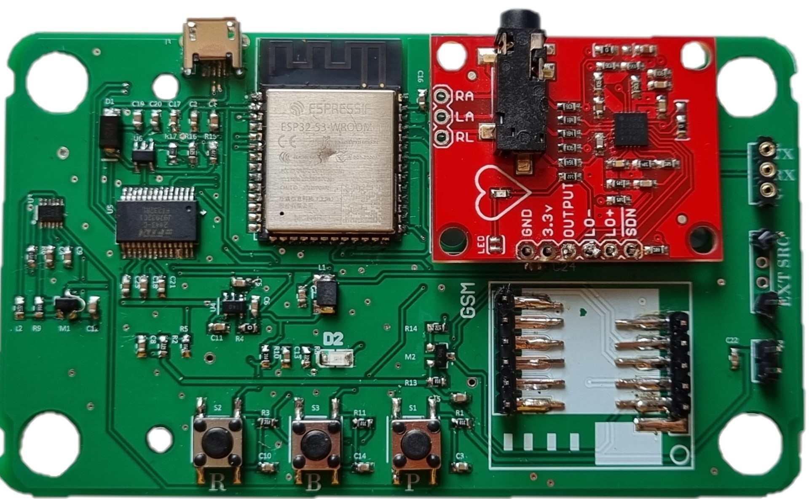
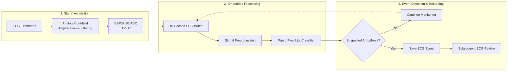
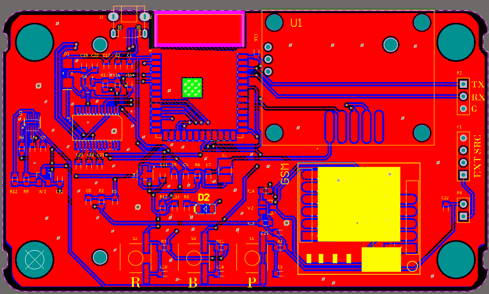

# Real-Time ECG Arrhythmia Detection & Event Recorder

  

  <strong>Bachelor's Thesis Project | University of Tehran</strong>

  Embedded Systems · ECG Signal Processing · TinyML · PCB Design

## Project Overview

This project presents the design and implementation of an ESP32-S3-based ECG event recorder for continuous cardiac signal monitoring and automatic detection of suspected arrhythmic events.

The system integrates an ECG analog front-end, low-power embedded signal acquisition, digital signal preprocessing, and an on-device machine-learning model.

Rather than continuously storing the entire ECG signal, the system identifies relevant arrhythmic events and preserves the associated ECG data for subsequent analysis.

The detection framework focuses on premature ventricular contractions (PVCs), premature atrial contractions (PACs), normal heartbeats, and signal artifacts.

## Key Features

- **Real-Time ECG Acquisition:** ECG signal sampling at approximately 195 Hz using the ESP32-S3 ADC.
- **Low-Power Operation:** RTC and ultra-low-power processing resources support periodic data acquisition.
- **Signal Preprocessing:** ECG normalization, peak detection, heartbeat segmentation, and input standardization.
- **Embedded Machine Learning:** Quantized TensorFlow Lite model for arrhythmia classification.
- **Event-Triggered Recording:** Storage of relevant ECG windows when suspected arrhythmias are detected.
- **Custom Hardware Design:** ECG front-end, battery-powered electronics, and custom PCB.

## System Architecture

The system integrates ECG signal acquisition, embedded signal
processing, machine-learning-based classification, and
event-triggered ECG recording.

**Operating Principle:** ECG signals are acquired and analyzed
in 10-second windows. When a suspected arrhythmic event is
detected, the relevant ECG segment is stored for subsequent review.
Otherwise, continuous monitoring proceeds.

## Hardware Implementation

The hardware integrates an ESP32-S3 microcontroller, ECG signal-conditioning circuitry, a rechargeable battery, power-management components, and communication interfaces.

The circuit schematic and PCB design files are provided for technical inspection and further development.

  

  <em>Custom PCB — Front View</em>

## ECG Processing and Machine Learning

The ECG processing pipeline operates on 10-second acquisition windows.

The preprocessing stage includes z-score normalization, heartbeat detection, signal segmentation, and input-length standardization.

A convolutional neural network was trained using annotated ECG data, including the MIT-BIH Arrhythmia Database.

The trained model was quantized for deployment on the ESP32-S3 using TensorFlow Lite.

The embedded system performs heartbeat classification and records ECG event data when suspected arrhythmias are identified.

## Hardware Demonstration

[**Watch the ECG Event Recorder Demonstration**](Demonstration/ECG_Event_Recorder_Demo.mp4)

The demonstration provides a visual overview of the hardware prototype and its operation.

## Technical Documentation

The complete bachelor's thesis includes the theoretical background, related research, hardware design, embedded signal-processing methods, machine-learning implementation, and event-recording mechanism.

[Full Technical Report – PDF](Report/Event_Recorder_Report.pdf)

## Project Scope

This repository presents an academic ECG-monitoring prototype and its engineering documentation. The project includes testing using ECG simulator signals.

The system is intended for research and educational purposes and is not presented as a clinically validated or certified medical device.

## Author

**Mohammad Mehdi Fazlollahpour**

Bachelor's Thesis — School of Electrical and Computer Engineering, University of Tehran

[GitHub Profile](https://github.com/Mm-Fazlollahpour)
